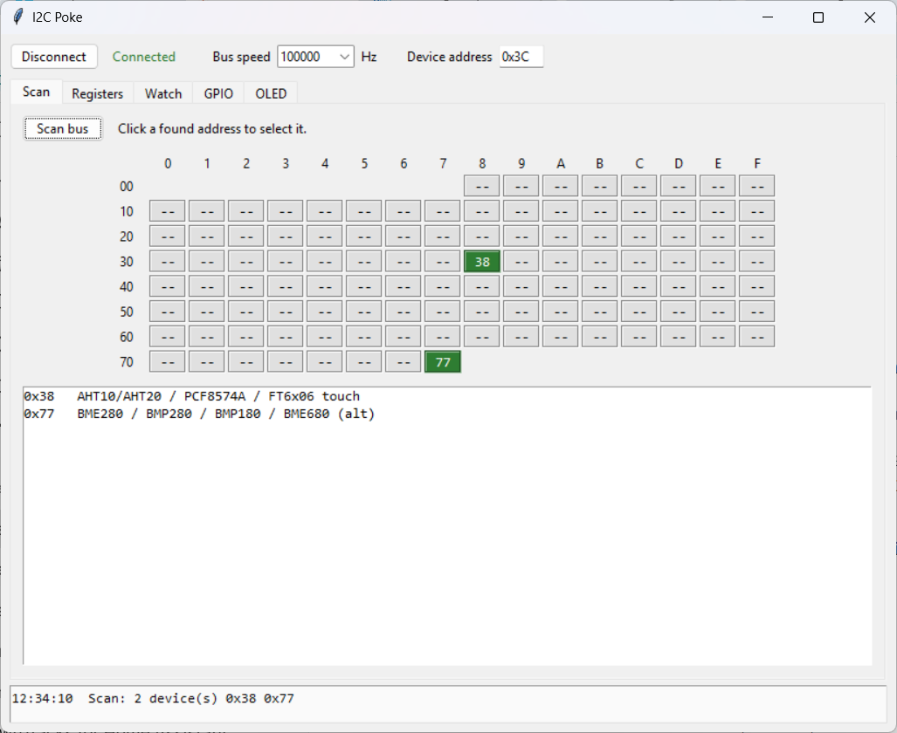
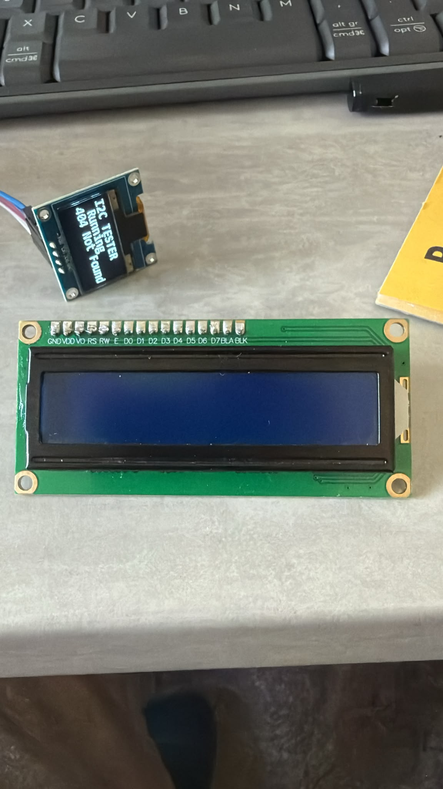
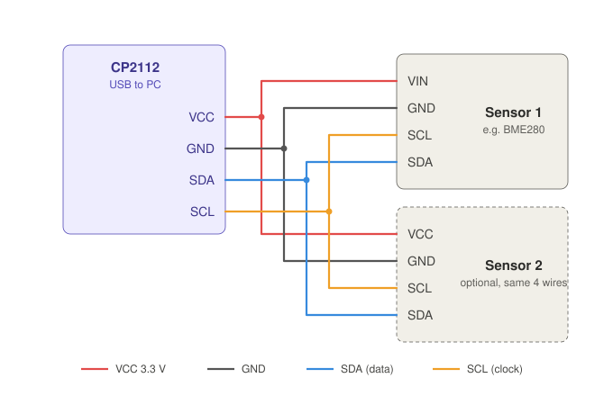
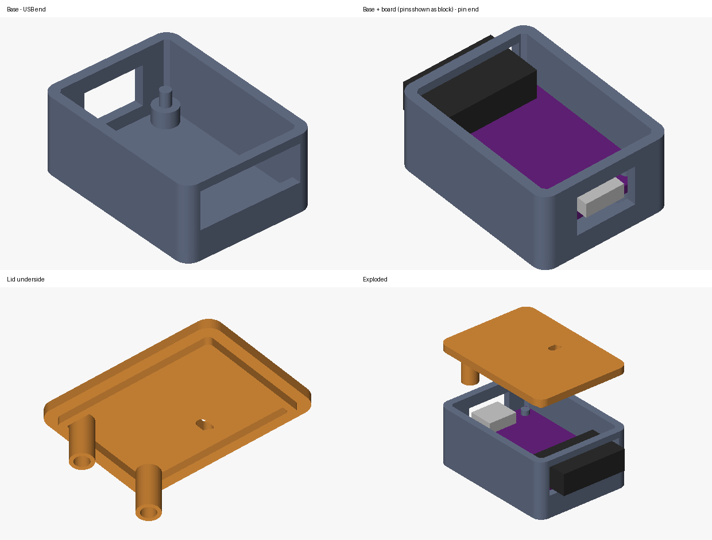

# I2C Poke

A bench I²C tester for Windows, built around the cheap **CP2112 USB-to-I²C/SMBus** breakout board (the purple CJMCU-2112 board).

Plug the board into a PC, connect any I²C chip, and I2C Poke scans the bus, works out which chip it is, and shows live readings in real units. No microcontroller and no firmware to flash. The CP2112 is a standard USB HID device, so Windows needs no driver.





## Features

| Tab | What it does |
|---|---|
| **Scan** | Address grid (0x08–0x77). Found devices light up with a likely chip name. Stops and reports bus faults (stuck SDA/SCL, missing pull-ups) instead of hanging. |
| **Registers** | Read, write and plain-read registers. Hex dump of 0x00–0xFF, saveable as a backup. 16-bit register addressing for large EEPROMs. |
| **Watch** | Polls a register on a timer and logs it to CSV. |
| **GPIO** | Toggles the board's spare IO5, IO6 and IO7 pins. |
| **OLED** | SSD1306/SH1106 displays (128×64, 128×32). Text, images (auto-dithered), test pattern, contrast, invert. |
| **LCD** | HD44780 16×2 and 20×4 character LCDs on a PCF8574 backpack. |
| **Sensors** | Quick readout for AHT20 + BMP280/BME280 combo boards. |
| **Devices** | Identifies every chip on the bus from a library of 44 drivers, with live readings, per-chip settings, controls and CSV logging. |

### Supported chips (Devices tab)

- **Environment:** AHT10/AHT20, BMP280, BME280, BMP180/BMP085, SHT30/31/35, SHT40/41/45, HTU21D/Si7021/SHT21, MCP9808, TMP102/LM75, MLX90614
- **Air quality:** SCD40/SCD41 (CO₂), SGP30, CCS811
- **Light:** BH1750, VEML7700, TSL2561, TSL2591, TCS34725, APDS9960
- **Power:** INA219, INA226, INA3221, MAX17048/43, smart battery packs (SBS: laptop, power-tool and e-bike packs)
- **Motion:** MPU6050/6500/9250, ADXL345, LIS3DH, LSM6DS3/DSL/DSOX, HMC5883L, QMC5883L, AS5600
- **Analog:** ADS1115/ADS1015 (with a divider setting for 0–25 V voltage modules), PCF8591, MCP4725
- **Outputs and I/O:** PCA9685 (PWM duty and servo angle), HT16K33, PCF8574, MCP23017, TCA9548A multiplexer
- **Time:** DS3231/DS1307, PCF8563 (set the clock from the PC time)
- **Memory and display:** 24Cxx EEPROM, SSD1306/SH1106 OLED
- **Identify only:** VL53L0X, BME680/BME688

Some chips share an address and have no ID register to tell them apart: PCF8563 and an EEPROM at 0x51, MCP23017 and PCF8574, PCF8591 and ADS1115. For these, select the device and pick the right one under **Treat as**.

## Getting started

### Option 1: download the .exe

Go to the [Releases](../../releases) page and download `I2CPoke.exe`. It's a single file and doesn't need installing.

### Option 2: build it yourself

1. Install [Python for Windows](https://www.python.org/downloads/) and tick **"Add python.exe to PATH"** during setup.
2. Download this repo (**Code → Download ZIP**) and unzip it.
3. Double-click **`build.bat`**. You'll find the result at `dist\I2CPoke.exe`.

To run it from source without building, use `py -m pip install hidapi pillow`, then `py i2cpoke_gui.pyw`.

### Command-line tool

`i2cpoke.py` also works on its own, on Windows, macOS and Linux:

```
python i2cpoke.py scan
python i2cpoke.py read 0x76 0xD0
python i2cpoke.py dump 0x50
python i2cpoke.py write 0x40 0x00 0x41 0x27
python i2cpoke.py watch 0x48 0x00 2
python i2cpoke.py gpio 5 on
```

On Linux, add a udev rule so you don't need sudo:

```
SUBSYSTEM=="hidraw", ATTRS{idVendor}=="10c4", ATTRS{idProduct}=="ea90", MODE="0666"
```

## Wiring



- Connect **VCC, GND, SDA and SCL** to the same-named pins on each device. Match the pins **by name**, because many breakouts put SCL before SDA.
- Measure the board's VCC pin first. It's normally 3.3 V.
- You can connect several devices in parallel, as long as each one has a unique address.
- **Character LCDs need 5 V on VCC.** Keep the grounds common. These LCDs give a blank or very faint display on 3.3 V.
- The board already has 4.7 kΩ pull-ups on it. With five or more breakouts on the bus, all their pull-ups add up, so you may need to remove some.

### Troubleshooting

| Symptom | Likely cause |
|---|---|
| "CP2112 not found" | USB cable is charge-only, or (on Linux) the udev rule is missing |
| Scan says "timed out" or "bus not free" | SDA and SCL swapped, GND missing, or a short |
| Scan finds nothing | Device isn't powered, or SDA and SCL are swapped |
| OLED found but blank | Wrong controller: switch between SSD1306 and SH1106, then press **Init display** |
| LCD backlight on but no text | Turn the blue contrast pot on the backpack |

## Enclosure

The `enclosure/` folder has a two-part 3D-printable case, about 34 × 25 × 16 mm. It has a micro-USB opening, an end slot for a **2×7 right-angle header**, and a window over the TX/RX LEDs. The lid clamps the board down with no screws.



- `cp2112_case.3mf` contains both parts, already oriented for printing. No supports needed, and PLA or PETG at 0.2 mm layers works.
- `cp2112_case_base.stl` and `cp2112_case_lid.stl` are the same parts as separate files.
- `cp2112_case.py` is the parametric generator, which needs only `numpy`. The board dimensions came from photos, so measure your board, edit the values at the top, then run `python cp2112_case.py`.

## Adding a chip

Drivers live in `devices.py`. Each one is a small class:

```python
class MyChip(Driver):
    name, addrs, category = "MYCHIP sensor", (0x42,), "Environment"

    @classmethod
    def identify(cls, dev, addr):
        return 2 if _rr(dev, addr, 0x0F)[0] == 0xAB else 0   # 2 = confirmed by ID register

    def read(self):
        d = self.rr(0x00, 2)
        return [("Temperature", s16be(*d) / 100, "°C")]
```

Add the class to `REGISTRY`. Drivers that can confirm a chip by an ID register should go before ones that can only guess. Settings (`settings = {...}`) and buttons (`actions = [...]`) appear in the app automatically.

## Tests

The tests run every driver against simulated chips, so no hardware is needed. Where a datasheet gives worked examples, the tests use them (for example, BMP280: 25.08 °C and 1006.53 hPa).

```
pip install pillow
python -m unittest discover -s tests -v
```

## Status

All the drivers are tested against simulated chips, but only some have been checked on real hardware: the CP2112 itself, an SSD1306/SH1106 OLED, and an AHT20 + BMP280 combo board. If a chip reads wrongly on real hardware, please open an issue and include the part number and the values you got.

## Licence

MIT. See [LICENSE](LICENSE).
